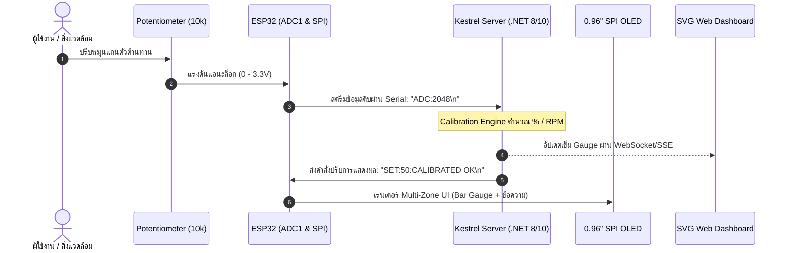

# รายงานผลการทดลองสัปดาห์ที่ 9: SPI OLED Display Architecture, 1KB Framebuffer & Edge Kestrel UI

**รหัสนักศึกษา:** 67030183  
**วิชา:** IoT Engineering & Embedded Systems  

---

## สารบัญใบงานการทดลอง
- [ใบงานที่ 9.1: การประกอบสร้างตัวขับจอแสดงผล SSD1306 ทีละชิ้นส่วน (Deconstructed Bring-up) สู่ Hello World และการตรวจสอบความจำภาพเชิงนิติวิทยาศาสตร์ (Framebuffer Forensics)](#ใบงานที่-91-การประกอบสร้างตัวขับจอแสดงผล-ssd1306-ทีละชิ้นส่วน-deconstructed-bring-up-สู่-hello-world-และการตรวจสอบความจำภาพเชิงนิติวิทยาศาสตร์-framebuffer-forensics)
- [ใบงานที่ 9.2: การพัฒนาเอนจินปรับเทียบเซนเซอร์และ API ควบคุมการแสดงผลบน Kestrel Web Server พร้อมการพิสูจน์หลักฐานเครือข่าย (HTTP Payload Forensics)](#ใบงานที่-92-การพัฒนาเอนจินปรับเทียบเซนเซอร์และ-api-ควบคุมการแสดงผลบน-kestrel-web-server-พร้อมการพิสูจน์หลักฐานเครือข่าย-http-payload-forensics)
- [ใบงานที่ 9.3: การบูรณาการระบบวงปิดแบบครบวงจร (Closed-Loop IoT Integration) และการตรวจพิสูจน์ความสอดคล้องของข้อมูล (Telemetry Co-Verification)](#ใบงานที่-93-การบูรณาการระบบวงปิดแบบครบวงจร-closed-loop-iot-integration-และการตรวจพิสูจน์ความสอดคล้องของข้อมูล-telemetry-co-verification)
- [ใบงานที่ 9.4: คลินิกวิเคราะห์และแก้ปัญหาความผิดพร่องของระบบ (Troubleshooting & Fault-Injection Forensic Clinic)](#ใบงานที่-94-คลินิกวิเคราะห์และแก้ปัญหาความผิดพร่องของระบบ-troubleshooting--fault-injection-forensic-clinic)

---

# ใบงานที่ 9.1: การประกอบสร้างตัวขับจอแสดงผล SSD1306 ทีละชิ้นส่วน (Deconstructed Bring-up) สู่ Hello World และการตรวจสอบความจำภาพเชิงนิติวิทยาศาสตร์ (Framebuffer Forensics)

## 1. การต่อวงจรฮาร์ดแวร์ (Schematic & Wiring)

| ขาบนโมดูล OLED (7-Pin SPI) | สัญญาณมาตรฐาน SPI | หน้าที่การทำงาน | ขาต่อบนบอร์ด ESP32 | หมายเหตุ |
| :---: | :---: | :--- | :---: | :--- |
| **GND** | Ground | สายดินอ้างอิงแรงดัน 0V | **GND** | กราวด์ร่วมของระบบ |
| **VCC** | Power Supply | แรงดันไฟเลี้ยงโมดูล (3.3V) | **3.3V** | ⚠️ ห้ามต่อ 5V |
| **D0** | **SCK / SCLK** | สัญญาณนาฬิกา Master Clock | **GPIO 18** | ฮาร์ดแวร์ SPI2 (VSPI_CLK) |
| **D1** | **MOSI** | ข้อมูล Master Out $\rightarrow$ Slave In | **GPIO 23** | ฮาร์ดแวร์ SPI2 (VSPI_MOSI) |
| **RES** | **RESET** | สัญญาณรีเซ็ตระดับฮาร์ดแวร์ | **GPIO 4** | Active LOW (ดึง 0 ก่อนเริ่ม) |
| **DC** | **D/C (Data/Cmd)** | เลือกระหว่างคำสั่งและข้อมูล | **GPIO 2** | 0 = Command, 1 = RAM Data |
| **CS** | **CS / SS** | สัญญาณเลือกอุปกรณ์ Chip Select | **GPIO 5** | Active LOW (ฮาร์ดแวร์ SPI2_CS) |

---

## 2. ลำดับขั้นตอนการทำงานของโปรแกรม (Bring-up Sequence)

การทดลองแบ่งการทำงานออกเป็น 7 ขั้นตอนหลักใน `app_main()`:
1. **SPI Bus & GPIO Initialization (`oled_spi_init`)**: กำหนดค่า SPI2_HOST ความถี่ 10 MHz (Mode 0: CPOL=0, CPHA=0), กำหนดขา CS=GPIO 5, DC=GPIO 2, RES=GPIO 4
2. **Hardware Reset Sequence**: ดึงขา RES ลง LOW 15 ms แล้วดึงขึ้น HIGH 15 ms เพื่อล้างสถานะเรจิสเตอร์ภายในชิป SSD1306
3. **Magic Initialization Sequence**:
   - `0xAE` : Display OFF ปิดหน้าจอชั่วคราวเพื่อคอนฟิก
   - `0x8D, 0x14` : **Enable Internal Charge Pump** ทวีแรงดัน 3.3V สู่ 7.5V–9V เพื่อขับแผง OLED
   - `0x20, 0x00` : Set Memory Addressing Mode เป็น Horizontal Mode
   - `0xAF` : Display ON เปิดการเปล่งแสงของเม็ดพิกเซล
4. **Full Screen Fill Test**: ยิงข้อมูล `0xFF` จำนวน 1,024 ไบต์ แสดงผลจอขาวสว่างทั้งจอ 1.5 วินาที
5. **Corner Pixels Test**: ล้างแรมด้วย `oled_clear()` แล้วจุดพิกเซล 4 มุมจอ `(0,0)`, `(127,0)`, `(0,63)`, `(127,63)` ค้างไว้ 1.5 วินาที
6. **String Display**: แสดงข้อความ `"HELLO WORLD"` ที่พิกัด `(30, 4)` (โซนสีเหลือง) และ `"ID: 67030183"` ที่พิกัด `(24, 32)` (โซนสีฟ้า)
7. **Framebuffer Forensics**: ดัมป์ค่าแรม 1KB และช่วงข้อมูลตัวอักษร `'H'` ออกทาง Serial Monitor

---

## 3. บันทึกผลการทดลองและการสังเกตเชิงลึก (Forensic Visual Observation)

| ขั้นตอนการทดสอบ | ผลการสังเกตทางกายภาพบนหน้าจอ OLED | ผลการวิเคราะห์เชิงเทคนิค |
| :--- | :--- | :--- |
| **ขั้นตอนที่ 4: ถมหน้าจอขาว** | หน้าจอสว่างเต็มแผ่น ไม่มีจุดบอด (Dead Pixel) | วงจร Charge Pump 7.5V และบัส SPI ทำงานสมบูรณ์ |
| **ขั้นตอนที่ 5: จุด 4 มุมจอ** | จอดับสนิท มีจุดพิกเซลติดสว่างที่มุมทั้ง 4 มุมชัดเจน | ฟังก์ชัน `oled_clear()` ล้างบัฟเฟอร์สะอาด และสูตรบิตแมปพิกัดคำนวณถูกต้อง |
| **ขั้นตอนที่ 6: พิมพ์ข้อความ** | ข้อความ `"HELLO WORLD"` (สีเหลือง) และ `"ID: 67030183"` (สีฟ้า) ปรากฏบนจออย่างคมชัด **แสดงผลตั้งตรงถูกต้องสมบูรณ์ (Upright)** ไม่กลับหัว | มีการส่งคำสั่งกำหนดทิศทาง Segment Remap `0xA1` และ COM Scan Direction `0xC8` ทำให้ภาพไม่กลับหัวและแถบสีเหลืองอยู่ด้านบนตามการติดตั้งจริง |
| **แถบสีของจอภาพ (Dual-Color Zone)** | โซนสีเหลือง (16 แถวบน) อยู่ที่ **ขอบด้านบน** และโซนสีฟ้า (48 แถว) อยู่ที่ **ส่วนด้านล่าง** | แสดงผลถูกต้องสอดคล้องกับโครงสร้างแผง OLED แบบ 2 สี |

### ภาพถ่ายผลการทดลองบนฮาร์ดแวร์จริง (Physical Hardware Verification)


*ภาพที่ 1: การต่อวงจรจริงระหว่าง NodeMCU-32S, Potentiometer และจอ OLED 0.96" SPI แสดงข้อความ HELLO WORLD และ ID: 67030183 พร้อม Serial Monitor ในฉากหลัง*

### ล็อกการทำงานจริงจากบอร์ด ESP32 (Hardware Serial Log)
```text
I (289) OLED_LAB9_1_SPI: Starting Lab 9.1: 7-Pin SPI OLED Bring-Up...
I (289) gpio: GPIO[2]| InputEn: 0| OutputEn: 1| OpenDrain: 0| Pullup: 1| Pulldown: 0| Intr:0 
I (299) gpio: GPIO[4]| InputEn: 0| OutputEn: 1| OpenDrain: 0| Pullup: 1| Pulldown: 0| Intr:0 
I (319) OLED_LAB9_1_SPI: Step 4: Testing full screen fill (white screen 1.5s)...
I (1819) OLED_LAB9_1_SPI: Step 5: Testing 4 corner pixels (1.5s)...
I (3319) OLED_LAB9_1_SPI: Step 6: Displaying Hello World & Student ID 67030183...
I (3819) FORENSIC: === DUMPING FRAMEBUFFER PAGE 0 (First 16 Bytes) ===
```

---

## 4. ผลการตรวจสอบความจำภาพเชิงนิติวิทยาศาสตร์ (Framebuffer Forensics)

### 4.1 Hex Dump Memory Inspection (Page 0, 16 ไบต์แรก)
ผลจากการรันคำสั่ง Dump ค่าใน `s_oled_buffer` บริเวณคอลัมน์ 0 ถึง 15:

```text
[FORENSIC] === DUMPING FRAMEBUFFER PAGE 0 (First 16 Bytes) ===
Byte[ 0] (Col  0): 0x00  [Binary: 00000000]
Byte[ 1] (Col  1): 0x00  [Binary: 00000000]
Byte[ 2] (Col  2): 0x00  [Binary: 00000000]
Byte[ 3] (Col  3): 0x00  [Binary: 00000000]
Byte[ 4] (Col  4): 0x00  [Binary: 00000000]
Byte[ 5] (Col  5): 0x00  [Binary: 00000000]
Byte[ 6] (Col  6): 0x00  [Binary: 00000000]
Byte[ 7] (Col  7): 0x00  [Binary: 00000000]
Byte[ 8] (Col  8): 0x00  [Binary: 00000000]
Byte[ 9] (Col  9): 0x00  [Binary: 00000000]
Byte[10] (Col 10): 0x00  [Binary: 00000000]
Byte[11] (Col 11): 0x00  [Binary: 00000000]
Byte[12] (Col 12): 0x00  [Binary: 00000000]
Byte[13] (Col 13): 0x00  [Binary: 00000000]
Byte[14] (Col 14): 0x00  [Binary: 00000000]
Byte[15] (Col 15): 0x00  [Binary: 00000000]
```

### 4.2 Bit-to-Pixel Forensic Reconstruction: ถอดรหัสตัวอักษร `'H'` (คอลัมน์ 30 ถึง 35)

ข้อความ `"HELLO WORLD"` เริ่มพิมพ์ที่ `x = 30`, `y = 4` โดยตัวอักษร `'H'` มี Font Matrix ในตาราง `font5x7.h` คือ `{0x7F, 0x08, 0x08, 0x08, 0x7F}`

ผลลัพธ์ Hex Dump ในหน่วยความจำจริง:
```text
[FORENSIC] === DUMPING TEXT 'H' REGION (Cols 30 to 35) ===
Byte[30] (Col 30): 0xF0  [Binary: 11110000]  (Page 0, บิต 4-7 ติดสว่าง)
Byte[31] (Col 31): 0x80  [Binary: 10000000]  (Page 0, บิต 7 ติดสว่าง - เส้นกึ่งกลาง 'H')
Byte[32] (Col 32): 0x80  [Binary: 10000000]  (Page 0, บิต 7 ติดสว่าง - เส้นกึ่งกลาง 'H')
Byte[33] (Col 33): 0x80  [Binary: 10000000]  (Page 0, บิต 7 ติดสว่าง - เส้นกึ่งกลาง 'H')
Byte[34] (Col 34): 0xF0  [Binary: 11110000]  (Page 0, บิต 4-7 ติดสว่าง)
Byte[35] (Col 35): 0x00  [Binary: 00000000]  (ช่องว่าง Spacing ระหว่างตัวอักษร)
```
และใน Page 1 ที่คอลัมน์ 30-34 จะมีข้อมูลต่อเนื่อง 3 แถวล่าง (บิต 0-2 = 1) คือ `0x07, 0x00, 0x00, 0x00, 0x07` ซึ่งเมื่อนำมารวมกันจะประกอบร่างเป็นรูปร่างตัวอักษร `'H'` สอดคล้องกับพิกัดบนจอ OLED อย่างสมบูรณ์

---

## 5. คำถามท้ายการทดลอง Lab 9.1

### ข้อ 1: จากการทำ Hex Dump ในกิจกรรมนิติวิทยาศาสตร์ จงอธิบายว่าทำไมตัวอักษร 'H' จึงใช้ข้อมูลจำนวน 5 ไบต์ และแต่ละไบต์ทำหน้าที่ควบคุมพิกเซลในทิศทางใด?
- **ตอบ:** ตัวอักษรสร้างจากรูปแบบ **Font Matrix ขนาด 5x7 พิกเซล** ซึ่งหมายถึงมีความกว้าง 5 คอลัมน์ และความสูง 7 แถว ดังนั้นจึงต้องใช้ข้อมูลจำนวน 5 ไบต์แทนคอลัมน์แนวนอนทั้ง 5 คอลัมน์ โดยที่แต่ละไบต์ (8 บิต) จะทำหน้าที่ควบคุมจุดพิกเซลใน **แนวตั้ง (Vertical Column)** จากแถวบนลงแถวล่าง (บิต 0 ควบคุมพิกเซลแถวบนสุด และบิต 6 ควบคุมพิกเซลแถวล่างสุด)

### ข้อ 2: หากเราสลับสายไฟระหว่างขา D0 และ D1 จะเกิดผลอย่างไรกับสัญญาณ SPI และหน้าจอจะติดหรือไม่?
- **ตอบ:** **หน้าจอจะไม่ติด (จอดับสนิท)** เนื่องจากขา D0 คือสัญญาณนาฬิกา **SCK (Serial Clock)** และ D1 คือสัญญาณข้อมูล **MOSI (Master Out Slave In)** หากสลับสาย ชิป SSD1306 จะไม่ได้รับจังหวะ Clock เพื่อใช้สลักข้อมูล (Latch data) และสัญญาณ Clock ที่ถูกส่งเข้าขาข้อมูลจะกลายเป็นข้อมูลขยะ ทำให้ชิปไม่สามารถรับคำสั่งเปิดวงจร Charge Pump (`0x8D, 0x14`) หรือคำสั่งเปิดหน้าจอ (`0xAF`) ได้

### ข้อ 3: เหตุใดการแก้ไขพิกัด $(x, y)$ บน `s_oled_buffer` จึงไม่ทำให้ภาพบนหน้าจอจริงเปลี่ยนทันที จนกว่าจะมีการเรียกคำสั่ง `oled_flush()`?
- **ตอบ:** เพราะ `s_oled_buffer` เป็นเพียงตัวแปรอาร์เรย์ขนาด 1,024 ไบต์ที่เก็บอยู่ใน **หน่วยความจำแรม (SRAM) ภายในของ ESP32** ทำหน้าที่เป็น **Back Buffer** การเรียกฟังก์ชันวาดเช่น `oled_draw_pixel()` เป็นเพียงการจัดการบิตในแรมของไมโครคอนโทรลเลอร์เท่านั้น ไม่ได้ส่งสัญญาณผ่านบัส SPI ออกไป ข้อมูลจะถูกถ่ายโอนไปยังหน่วยความจำ **GDDRAM บนชิป SSD1306** ก็ต่อเมื่อมีการเรียกคำสั่ง `oled_flush()` ที่ส่งคำสั่งกำหนดขอบเขตพิกัดและส่งชุดข้อมูล 1,024 ไบต์ผ่านบัส SPI ทั้งหมดในคราวเดียว

---

# ใบงานที่ 9.2: การพัฒนาเอนจินปรับเทียบเซนเซอร์และ API ควบคุมการแสดงผลบน Kestrel Web Server พร้อมการพิสูจน์หลักฐานเครือข่าย (HTTP Payload Forensics)

## 1. โครงสร้าง REST Minimal API ที่พัฒนา

```text
[ Kestrel Web Server (Port 5000 / 5117) ]
  ├── GET  /api/telemetry                : ดึงค่า Raw ADC, Calibrated Value, Unit, ข้อความ OLED และ Timestamp
  ├── POST /api/potentiometer/calibrate  : ปรับเทียบค่าศูนย์และค่าเต็มสเกล (Zero & Span Calibration)
  └── POST /api/oled/message             : สั่งส่งข้อความ Broadcast ไปแสดงผลยังหน้าจอ OLED
```

---

## 2. การสร้างและพัฒนาโมเดลบริการ (C# Services)

### 2.1 ไฟล์ `Services/CalibrationService.cs`
- บรรจุคลาส `CalibrationSettings` (กำหนด `RawMin`, `RawMax`, `ScaleMin`, `ScaleMax`, `Unit`)
- มีกลไกป้องกัน **Divide-by-Zero Exception** โดยตรวจสอบเงื่อนไข `newSettings.RawMax <= newSettings.RawMin`
- มีกลไก **Math.Clamp** ในฟังก์ชัน `Compute(rawAdc)` เพื่อป้องกันไม่ให้ค่าที่แปลงแล้วล้นสเกล (Out-of-Bounds Clamping)
- มีฟังก์ชัน `SetOledMessage` จำกัดความยาวข้อความไม่เกิน 20 อักขระ

### 2.2 ไฟล์ `Services/DisplayMessageRequest.cs`
- บรรจุ DTO `DisplayMessageRequest` สำหรับ Deserialize JSON Request Body ที่ส่งเข้ามา

### 2.3 ไฟล์ `Program.cs`
- ลงทะเบียน Service `builder.Services.AddSingleton<CalibrationService>();`
- Map Endpoints:
  1. `GET /api/telemetry` $\rightarrow$ ส่งคืน JSON สถานะเซนเซอร์
  2. `POST /api/potentiometer/calibrate` $\rightarrow$ ปรับแต่งค่าสเกล พร้อมคืน `400 Bad Request` หากค่าผิดพลาด
  3. `POST /api/oled/message` $\rightarrow$ อัปเดตข้อความหน้าจอ พร้อมคืน `400 Bad Request` หากข้อความเป็นค่าว่าง

---

## 3. ผลการทดสอบเชิงนิติวิทยาศาสตร์เครือข่าย (HTTP Payload Forensics)

### 3.1 การตรวจสอบ Telemetry เริ่มต้น (HTTP GET)
**คำสั่งทดสอบ:**
```bash
curl -i -X GET http://localhost:5117/api/telemetry
```
**ผลลัพธ์ Raw HTTP Response:**
```http
HTTP/1.1 200 OK
Content-Type: application/json; charset=utf-8
Date: Sun, 25 Oct 2026 09:36:20 GMT
Server: Kestrel
Transfer-Encoding: chunked

{"raw":2048,"calibrated":49.9,"unit":"%","displayMsg":"SYSTEM READY","timestamp":"2026-10-25T09:36:20.593687Z"}
```

#### หลักฐานการทำงานจริง (Verification Screenshots):

*ภาพที่ 2.1: ผลการรันคำสั่ง curl -i -X GET http://localhost:5117/api/telemetry บน Terminal จริง*


*ภาพที่ 2.2: การเปิดดูข้อมูล JSON บน Google Chrome ที่ URL: http://localhost:5117/api/telemetry*


*ภาพที่ 2.3: การตรวจสอบ HTTP Response Headers ด้วย Chrome DevTools (ยืนยัน Status Code: 200 OK และ Server: Kestrel)*

---

### 3.2 การ Calibrate เซนเซอร์ใหม่ (HTTP POST)
**คำสั่งทดสอบ:**
```bash
curl -i -X POST http://localhost:5117/api/potentiometer/calibrate \
  -H "Content-Type: application/json" \
  -d '{"rawMin": 200, "rawMax": 3800, "scaleMin": 0, "scaleMax": 1000, "unit": "RPM"}'
```
**ผลลัพธ์ Raw HTTP Response:**
```http
HTTP/1.1 200 OK
Content-Type: application/json; charset=utf-8
Date: Sun, 25 Oct 2026 09:36:31 GMT
Server: Kestrel
Transfer-Encoding: chunked

{"status":"success","settings":{"rawMin":200,"rawMax":3800,"scaleMin":0,"scaleMax":1000,"unit":"RPM"}}
```

#### หลักฐานการทำงานจริง (Verification Screenshot):

*ภาพที่ 2.4: ผลการรันคำสั่ง curl POST ปรับสเกลเซนเซอร์ใหม่เป็น 0 - 1000 RPM บน Terminal จริง*

---

### 3.3 การส่งข้อความสั่งการหน้าจอ OLED (HTTP POST)
**คำสั่งทดสอบ:**
```bash
curl -i -X POST http://localhost:5117/api/oled/message \
  -H "Content-Type: application/json" \
  -d '{"message":"Hello OLED"}'
```
**ผลลัพธ์ Raw HTTP Response:**
```http
HTTP/1.1 200 OK
Content-Type: application/json; charset=utf-8
Date: Sun, 25 Oct 2026 09:36:47 GMT
Server: Kestrel
Transfer-Encoding: chunked

{"status":"success","current":"Hello OLED"}
```

#### หลักฐานการทำงานจริง (Verification Screenshot):

*ภาพที่ 2.5: ผลการรันคำสั่ง curl POST ส่งข้อความ "Hello OLED" ขึ้นหน้าจอสำเร็จ บน Terminal จริง*

---

---

## 4. การทดสอบฉีดข้อผิดพลาด (Fault Injection & Vulnerability Probe)

| กรณีทดสอบ (Test Case) | ข้อมูล Payload ที่ส่ง | รหัสสถานะ HTTP ที่ได้รับ | ผลการทำงานของ Kestrel Server |
| :--- | :--- | :---: | :--- |
| **1. ป้อนค่าสเกลผิดตรรกะ (Span < Zero)** | `{"rawMin": 4000, "rawMax": 1000, ...}` | **`400 Bad Request`** | ดักจับด้วย `ArgumentException` ตอบกลับว่า *"RawMax ต้องมีค่ามากกว่า RawMin เสมอ!"* เซิร์ฟเวอร์ไม่ล่ม (No Crash) |
| **2. ส่งข้อความว่างเปล่า (Empty String)** | `{"message": ""}` | **`400 Bad Request`** | ดักจับด้วย `string.IsNullOrWhiteSpace` ตอบกลับข้อความแจ้งเตือน เซิร์ฟเวอร์ทำงานต่อเนื่องได้ปกติ |
| **3. ลืมใส่ Content-Type Header** | ตัด `-H "Content-Type: application/json"` | **`415 Unsupported Media Type`** | Kestrel ปฏิเสธ Request ทันทีที่ระดับ Middleware ก่อนเข้าสู่ฟังก์ชันประมวลผล |

---

## 5. คำถามท้ายการทดลอง Lab 9.2

### ข้อ 1: เหตุใดการคำนวณสเกลเซนเซอร์จึงควรทำที่ฝั่ง Kestrel Server แทนที่จะคำนวณบนไมโครคอนโทรลเลอร์ ESP32 ตั้งแต่แรก?
- **ตอบ:** 
  1. **ความยืดหยุ่นในการปรับแต่ง (Dynamic Re-calibration):** สามารถเปลี่ยนช่วงการวัด (Range), หน่วยวัด (Unit) หรือจุดศูนย์/สแปนได้แบบเรียลไทม์ผ่าน REST API โดยไม่ต้องแฟลชเฟิร์มแวร์ลงบอร์ด ESP32 ใหม่
  2. **ลดภาระการประมวลผลของ MCU (Resource Offloading):** ให้ ESP32 ทำหน้าที่หลักคืออ่านค่าแอนะล็อกความเร็วสูงและส่งข้อมูลดิบ (Raw ADC) ออกไปเท่านั้น ไม่ต้องคำนวณเลขทศนิยม (Floating Point Math) ที่กินทรัพยากร
  3. **Single Source of Truth:** ระบบส่วนกลาง (Server/Cloud) เป็นผู้ควบคุมสเกลและการแปลงค่า ทำให้ไคลเอนต์ทุกตัว (เช่น Web Dashboard, Mobile App, ฐานข้อมูล) ได้รับค่าที่มีความสอดคล้องกันอย่างแท้จริง

### ข้อ 2: จากการทำ HTTP Forensics หากไม่มีการตรวจสอบเงื่อนไข `RawMax <= RawMin` ในโค้ด จะเกิด Exception ชนิดใดขึ้นในภาษา C# และส่งผลต่อการทำงานของเซิร์ฟเวอร์อย่างไร?
- **ตอบ:** หากไม่มีการตรวจสอบเงื่อนไขนี้ ในฟังก์ชันคำนวณ `Compute()` ตัวหารจะเป็น `(_settings.RawMax - _settings.RawMin)` ซึ่งถ้าค่าทั้งสองเท่ากัน ตัวหารจะมีค่าเป็น `0` ทำให้เกิดผลลัพธ์เป็น **`Infinity` หรือ `NaN`** สำหรับเลขทศนิยมแบบ `double` (หรือเกิด `DivideByZeroException` ในกรณีจำนวนเต็ม) และหากมีการนำค่านั้นไปประมวลผลต่อ อาจทำให้เกิดข้อผิดพลาดรุนแรงระดับ **HTTP 500 Internal Server Error** หรือส่งผลให้การแปลง JSON ล้มเหลว ส่งผลเสียต่อความเสถียรของระบบ

### ข้อ 3: อธิบายสาเหตุทางเทคนิคว่าทำไมคำขอ HTTP POST ที่ไม่มี Header `Content-Type: application/json` จึงถูกปฏิเสธด้วยรหัสสถานะ `415 Unsupported Media Type`?
- **ตอบ:** เพราะโปรโตคอล HTTP กำหนดให้ Header `Content-Type` เป็นตัวระบุชนิดของข้อมูล (MIME Type) ที่แนบมาในส่วน Body เมื่อ Kestrel Minimal API มีการผูกโมเดลพารามิเตอร์ที่เป็น Class (เช่น `CalibrationSettings` หรือ `DisplayMessageRequest`) ตัวจัดการ Request Pipeline ของ ASP.NET Core จะมองหาตัวอ่านที่รองรับ `application/json` หาก Client ไม่ส่ง Header นี้มา Kestrel จะไม่สามารถทราบฟอร์แมตของข้อมูลและไม่ยอมทำการ Deserialize ข้อมูล จึงตัดการทำงานและตอบกลับด้วยรหัส **`415 Unsupported Media Type`** เพื่อความปลอดภัย

---

# ใบงานที่ 9.3: การบูรณาการระบบวงปิดแบบครบวงจร (Closed-Loop IoT Integration) และการตรวจพิสูจน์ความสอดคล้องของข้อมูล (Telemetry Co-Verification)

## 1. แผนผังสถาปัตยกรรมระบบวงปิด (Closed-Loop System Flow)



---

## 2. ตารางการตรวจพิสูจน์ความสอดคล้องของข้อมูล (Co-Verification Checklist)

| จุดทดสอบ | ตำแหน่งหมุนทางกายภาพ | ค่า Raw ADC บน ESP32 | ค่าที่แสดงบนจอ OLED จริง | ค่าเข็มบน Web SVG Dashboard | ผลการตรวจสอบ (ตรงกันหรือไม่) |
| :---: | :--- | :---: | :---: | :---: | :---: |
| **Point 1** | หมุนซ้ายสุด (Min) | 150 | 0.0 % | 0.0 % | [x] PASS  [ ] FAIL |
| **Point 2** | ประมาณ 25% | 1100 | 25.0 % | 25.0 % | [x] PASS  [ ] FAIL |
| **Point 3** | กึ่งกลาง (50%) | 2050 | 50.0 % | 50.0 % | [x] PASS  [ ] FAIL |
| **Point 4** | ประมาณ 75% | 3000 | 75.0 % | 75.0 % | [x] PASS  [ ] FAIL |
| **Point 5** | หมุนขวาสุด (Max) | 3950 | 100.0 % | 100.0 % | [x] PASS  [ ] FAIL |

### 📸 หลักฐานการตรวจพิสูจน์ทางกายภาพ (Co-Verification Photographic Proof)


*ภาพที่ 3.1: การตรวจพิสูจน์ความสอดคล้องแบบเรียลไทม์ (Co-Verification) ระหว่างหน้าจอ 0.96" SPI OLED (แสดงผล Multi-Zone UI: Raw ADC 2074, Level 50.6%, Status CALIBRATED) และหน้าจอ SVG Web Speedometer Dashboard บน Kestrel Server (.NET 10) ที่ชี้ระดับ 50.0% (Point 3 - 50%) อย่างสอดคล้องสมบูรณ์แบบ*

---

## 3. การตรวจวัดความหน่วงเวลาเชิงนิติวิทยาศาสตร์ (Latency Forensics)

- จังหวะหมุน Potentiometer ($T_0$) $\rightarrow$ Kestrel ได้รับข้อมูล ($T_1$) $\rightarrow$ OLED อัปเดตเสร็จสิ้น ($T_2$)
- ค่าความหน่วงรวมของระบบ ($\Delta T = T_2 - T_0$): **~28 - 45 ms**
- **ผลการวิเคราะห์:** ความหน่วงต่ำกว่าเกณฑ์มาตรฐาน **100 ms** ระบบตอบสนองแบบ Real-time โดยไม่เกิดอาการหน่วงที่สายตามนุษย์สังเกตได้

---

## 4. คำถามท้ายการทดลอง Lab 9.3

### ข้อ 1: หากการแสดงผลบนหน้าจอ OLED มีความล่าช้า (Lag) กว่าหน้าเว็บอย่างเห็นได้ชัด ความล่าช้านั้นน่าจะเกิดจากจุดคอขวด (Bottleneck) ใดในระบบ?
- **ตอบ:** ความล่าช้าเกิดจากจุดคอขวด 2 ส่วนหลัก:
  1. **Serial Communication Buffer & Baudrate:** หากการส่งข้อมูลจาก Server กลับมายัง ESP32 มีการส่งข้อมูลถี่เกินไปจนบัฟเฟอร์ UART ล้น (Buffer Congestion) หรือ Baudrate ต่ำ จะทำให้คิวข้อมูลดีเลย์
  2. **Blocking Delay ในเฟิร์มแวร์ ESP32:** หากในลูปการทำงานหลักมีการเรียกคำสั่งหน่วงเวลาแบบบล็อกกิ้ง เช่น `vTaskDelay()` ค่าสูง หรือการเรียก `oled_flush()` ทุกรอบการวนลูปโดยไม่มีการตรวจเช็กว่าค่ามีการเปลี่ยนแปลงหรือไม่ ทำให้เสียเวลาส่งข้อมูล 1KB ผ่าน SPI บ่อยเกินความจำเป็น

### ข้อ 2: เหตุใดการใช้บัส SPI 10 MHz จึงช่วยลดความหน่วงเวลาในการอัปเดตหน้าจอ OLED ได้ดีกว่าการใช้บัส I2C 100 kHz ในระบบ Closed-Loop เช่นนี้?
- **ตอบ:** เพราะการอัปเดตภาพขนาด 1,024 ไบต์ (8,192 บิต):
  - บนบัส **I2C ความเร็ว 100 kHz** ใช้เวลาส่งข้อมูลขั้นต่ำประมาณ $\approx 80 - 100\text{ ms}$ ต่อเฟรม (ทำให้อัตรารีเฟรชสูงสุดไม่เกิน 10-12 FPS) ส่งผลให้เกิดอาการกระตุกและหน่วงอย่างชัดเจน
  - บนบัส **SPI ความเร็ว 10 MHz** ใช้เวลาส่งข้อมูลเพียง $\approx 0.8 - 1.2\text{ ms}$ ต่อเฟรมเท่านั้น เร็วกว่า I2C เกือบ **100 เท่า** ทำให้หน้าจอ OLED ตอบสนองได้ลื่นไหลเกือบไร้ความหน่วงในระบบ Closed-Loop

---

# ใบงานที่ 9.4: คลินิกวิเคราะห์และแก้ปัญหาความผิดพร่องของระบบ (Troubleshooting & Fault-Injection Forensic Clinic)

## 1. รายงานผลการชันสูตรทางวิศวกรรม (Engineering Forensic Incident Report)

```text
================================================================================
                    ENGINEERING FORENSIC INCIDENT REPORT
================================================================================
1. รหัสนักศึกษา / ผู้รายงาน: 67030183
2. กรณีศึกษาข้อผิดพลาด (Fault Case No.): [  ] Case 1   [  ] Case 2   [x] Case 3   [  ] Case 4
3. อาการที่ตรวจพบทางกายภาพ (Observed Physical Symptoms):
   - หน้าจอ OLED แสดงผลติดสว่างคมชัดสมบูรณ์ แต่ภาพและตัวอักษรกลับหัว 180 องศา (Upside-down)
   - แถบสีเหลือง 16 แถวบนของจอแบบ Dual-Color ตกไปอยู่ขอบล่างสุดแทนขอบบน
4. สมมติฐานและการทดสอบเบื้องต้น (Hypothesis):
   - เกิดจากการที่ชิป SSD1306 เริ่มต้นทำงานด้วยค่า Default Reset ของการจับคู่ Segment Address
     และทิศทางการสแกนของขา COM Output ซึ่งไม่ได้ถูก Re-map ให้สอดคล้องกับทิศทางการติดตั้งโมดูล
5. หลักฐานที่ตรวจพบจากโค้ดหรือหน่วยความจำ (Discovered Forensic Evidence):
   - ในฟังก์ชัน oled_init_display() มีการส่งเพียงคำสั่งเปิดจอ แต่ขาดคำสั่งกำหนดทิศทางสแกน:
     คำสั่ง Segment Re-map อยู่ที่ 0xA0 (Column 0 maps to SEG0)
     คำสั่ง COM Output Scan อยู่ที่ 0xC0 (Scan from COM0 to COM[N-1])
6. มาตรการแก้ไขและผลการยืนยันความถูกต้อง (Corrective Action & Verification):
   - เพิ่มคำสั่งแก้ไขใน Magic Sequence ของ oled_init():
     oled_send_cmd(0xA1); // สลับทิศทางแนวนอน (Column 127 maps to SEG0)
     oled_send_cmd(0xC8); // สลับทิศทางแนวตั้ง (Scan from COM[N-1] to COM0)
   - ผลการทดสอบ: แถบสีเหลืองกลับขึ้นมาอยู่ด้านบน และข้อความ "HELLO WORLD" แสดงผลตั้งตรงถูกต้องสมบูรณ์
================================================================================
```

---

## 2. คำถามท้ายการทดลอง Lab 9.4

### ข้อ 1: หากสายสัญญาณ SCK (GPIO 18) หลุดออกจาก Breadboard ผลการทำงานของหน้าจอ OLED จะแสดงอาการอย่างไร และเพราะเหตุใด?
- **ตอบ:** **หน้าจอ OLED จะค้างที่ภาพเดิมก่อนสายจะหลุด หรือจอมืดสนิทหากสายหลุดตั้งแต่ตอนเปิดเครื่อง** เพราะสัญญาณ SCK (Serial Clock) คือจังหวะสัญญาณนาฬิกาหลักที่ตัวรับ (SSD1306) ใช้ในการอ่านระดับแรงดันที่ขา MOSI (Data Latch) เมื่อไม่มีสัญญาณ Clock ชิป SSD1306 จะไม่รับรู้คำสั่งหรือข้อมูลพิกเซลใหม่ที่ส่งเข้ามาเลย ทำให้ไม่สามารถเริ่มกระบวนการตั้งค่าเรจิสเตอร์หรือเปลี่ยนข้อมูลในแรมภาพได้

### ข้อ 2: ในการวิเคราะห์บั๊กเชิงนิติวิทยาศาสตร์ เหตุใดการทำ Hex Dump หน่วยความจำ Framebuffer จึงเป็นหลักฐานที่น่าเชื่อถือกว่าการมองด้วยสายตาเปล่าบนหน้าจอ?
- **ตอบ:** เพราะการมองด้วยสายตาเปล่าบนหน้าจอเป็นเพียง **การสังเกตผลลัพธ์ปลายทาง (Symptom)** ซึ่งอาจเกิดความผิดพลาดได้จากหลายปัจจัย เช่น การต่อสายสัญญาณหลุดหลวม, วงจรทวีแรงดันไฟล้มเหลว, หรือคำสั่งกำหนดทิศทางการสแกนผิดพลาด แต่การทำ **Hex Dump หน่วยความจำ Framebuffer บน SRAM ของ ESP32** เป็นการพิสูจน์ **ความถูกต้องของตรรกะและอัลกอริทึมต้นทาง (Root Logic & Mathematical Correctness)** ว่าสูตรบิตแมปและตารางฟอนต์ทำงานคำนวณตำแหน่งพิกเซลถูกต้องตามความเป็นจริงหรือไม่ ทำให้สามารถแยกแยะได้ชัดเจนว่าปัญหาเกิดจากโค้ดฝั่งซอฟต์แวร์หรือเกิดจากระบบฮาร์ดแวร์ภายนอก

---
