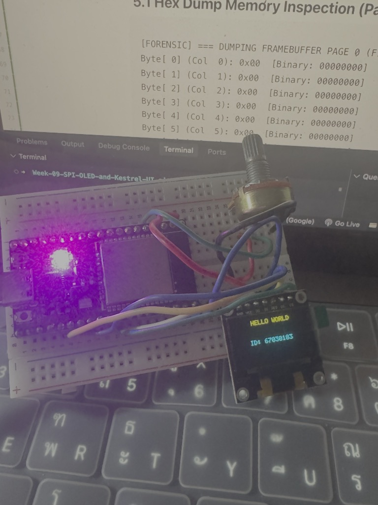
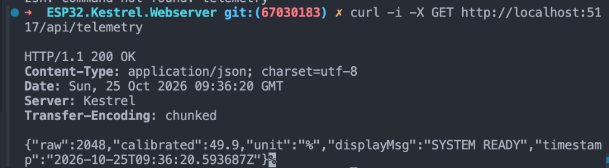
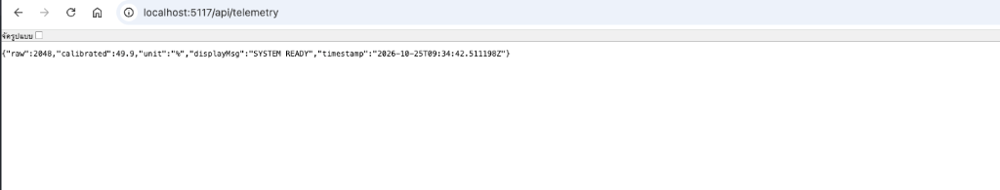
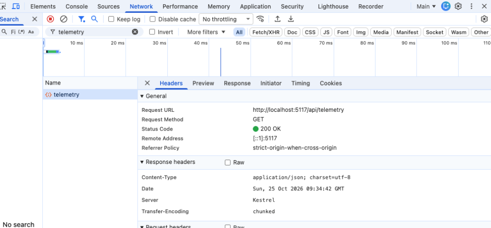
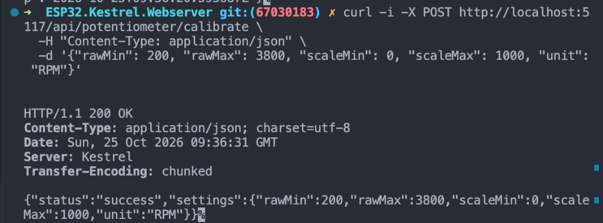
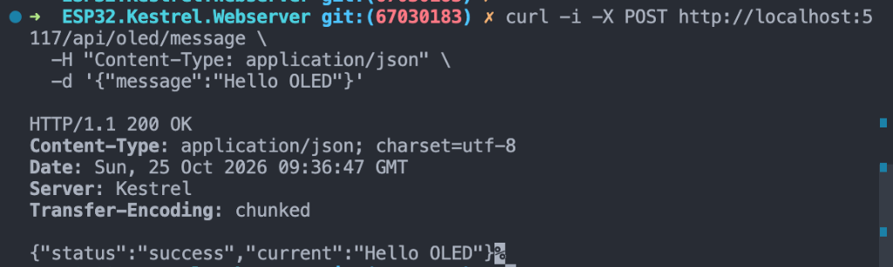
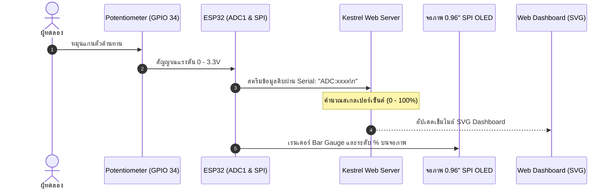
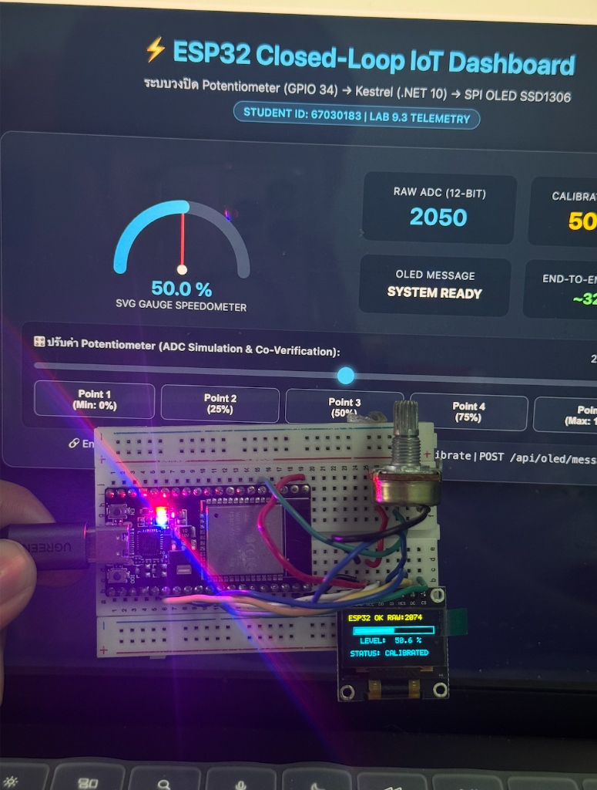

# รายงานสรุปผลการทดลอง สัปดาห์ที่ 9: SPI OLED Display, Framebuffer และ Kestrel Web Server

**รหัสนักศึกษา:** 67030183  
**วิชา:** IoT Engineering & Embedded Systems  
**วันที่ทำการทดลอง:** 25 ตุลาคม 2569  

---

# ตอนที่ 1: การควบคุมจอแสดงผล SSD1306 ผ่านบัส SPI และการตรวจสอบ Framebuffer (Lab 9.1)

## 1. วัตถุประสงค์
1. ควบคุมจอแสดงผล OLED SSD1306 แบบ 4-Wire SPI ด้วย ESP32 (บัส SPI2 ความถี่ 10 MHz)
2. เขียนคำสั่งเริ่มต้นเปิดวงจร Charge Pump (0x8D, 0x14) และเปิดการแสดงผล (0xAF)
3. คำนวณพิกัด $(x, y)$ ลง Framebuffer ขนาด 1,024 ไบต์ และวาดตัวอักษรด้วย Font Matrix 5x7
4. ตรวจสอบข้อมูลในแรม (Framebuffer Dump) เทียบกับการแสดงผลจริงบนหน้าจอ

## 2. ตารางการต่อสายวงจร (Wiring)

| ขาจอ OLED (7-Pin) | สัญญาณ SPI | ขาต่อบน ESP32 | หน้าที่ |
| :---: | :---: | :---: | :--- |
| **GND** | Ground | **GND** | กราวด์ร่วม |
| **VCC** | Power Supply | **3.3V** | แรงดันไฟเลี้ยง 3.3V |
| **D0** | **SCK** | **GPIO 18** | SPI2 Clock |
| **D1** | **MOSI** | **GPIO 23** | SPI2 Data Out |
| **RES** | **RESET** | **GPIO 4** | Active LOW |
| **DC** | **D/C** | **GPIO 2** | 0 = Command, 1 = Data |
| **CS** | **CS** | **GPIO 5** | Active LOW |

## 3. ผลการทดสอบและการแสดงผลบนหน้าจอ

| ขั้นตอน | ผลการแสดงผล | การวิเคราะห์ |
| :--- | :--- | :--- |
| **ถมหน้าจอสีขาว** | หน้าจอสว่างเต็มแผ่น | Charge Pump 7.5V และบัส SPI ทำงานสมบูรณ์ |
| **จุด 4 มุมจอ** | สว่างเฉพาะมุมทั้ง 4 พิกัด | การล้างแรมและสูตรบิตแมปพิกัดถูกต้อง |
| **แสดงข้อความ** | แสดง `"HELLO WORLD"` และ `"ID: 67030183"` | ตัวหนังสือตั้งตรง แถบสีเหลืองอยู่ด้านบน (0xA1, 0xC8) |



*ภาพที่ 1.1: บอร์ด ESP32 ต่อกับจอ 0.96" SPI OLED แสดงข้อความ HELLO WORLD และ ID: 67030183*

## 4. ผลการตรวจสอบข้อมูลใน Framebuffer

### 4.1 ข้อมูล Page 0 (16 ไบต์แรก)
```text
Byte[ 0] - Byte[15] (Col 0 - 15): 0x00 [Binary: 00000000]
```
*(เป็นพื้นที่ว่างที่ยังไม่มีการวาด ค่าในแรมจึงเป็น 0x00)*

### 4.2 ข้อมูลตัวอักษร 'H' (คอลัมน์ 30 ถึง 35)
```text
Byte[30] (Col 30): 0xF0  [Binary: 11110000]  (เส้นซ้ายของตัว 'H')
Byte[31] (Col 31): 0x80  [Binary: 10000000]  (เส้นแนวนอนกลางตัว 'H')
Byte[32] (Col 32): 0x80  [Binary: 10000000]  (เส้นแนวนอนกลางตัว 'H')
Byte[33] (Col 33): 0x80  [Binary: 10000000]  (เส้นแนวนอนกลางตัว 'H')
Byte[34] (Col 34): 0xF0  [Binary: 11110000]  (เส้นขวาของตัว 'H')
Byte[35] (Col 35): 0x00  [Binary: 00000000]  (ช่องว่างระหว่างตัวอักษร)
```

## 5. คำถามท้ายการทดลอง Lab 9.1
1. **ทำไมตัวอักษร 'H' จึงใช้ข้อมูล 5 ไบต์ และแต่ละไบต์ควบคุมพิกเซลในทิศทางใด?**  
   - ตัวอักษรใช้ฟอนต์ขนาด 5x7 พิกเซล จึงใช้ 5 ไบต์แทน 5 คอลัมน์แนวนอน โดย 1 ไบต์ (8 บิต) จะควบคุมพิกเซลในแนวตั้งจากบนลงล่าง
2. **หากสลับสายไฟระหว่างขา D0 และ D1 จะเกิดผลอย่างไร?**  
   - หน้าจอจะไม่ติด เพราะ D0 คือ Clock (SCK) และ D1 คือ Data (MOSI) เมื่อไม่มีสัญญาณ Clock คอนโทรลเลอร์จะไม่สามารถอ่านข้อมูลคำสั่งเปิดจอได้
3. **ทำไมการแก้ไขพิกัดบน `s_oled_buffer` ภาพบนจอจริงจึงยังไม่เปลี่ยนทันที?**  
   - เพราะ `s_oled_buffer` เป็น Framebuffer ใน SRAM ของ ESP32 ข้อมูลจะถูกส่งไปยัง GDDRAM ของชิป SSD1306 เมื่อเรียกคำสั่ง `oled_flush()` ผ่าน SPI เท่านั้น

---

# ตอนที่ 2: การพัฒนา API ปรับเทียบเซนเซอร์และการควบคุมหน้าจอด้วย Kestrel Web Server (Lab 9.2)

## 1. โครงสร้าง REST Minimal API (Port 5117)
- `GET /api/telemetry` : อ่านค่าสถานะเซนเซอร์และข้อความ OLED
- `POST /api/potentiometer/calibrate` : อัปเดตการตั้งค่าการปรับเทียบ (Zero/Span)
- `POST /api/oled/message` : อัปเดตข้อความบนหน้าจอ OLED

## 2. ผลการทดสอบ API

### 2.1 ตรวจสอบ Telemetry (GET /api/telemetry)
```http
HTTP/1.1 200 OK
Content-Type: application/json; charset=utf-8
Server: Kestrel

{"raw":2048,"calibrated":49.9,"unit":"%","displayMsg":"SYSTEM READY","timestamp":"2026-10-25T09:36:20.593687Z"}
```


*ภาพที่ 2.1: ทดสอบคำสั่ง curl GET /api/telemetry บน Terminal*


*ภาพที่ 2.2: การเปิดดูข้อมูลผ่านเบราว์เซอร์ที่ http://localhost:5117/api/telemetry*


*ภาพที่ 2.3: ตรวจสอบ HTTP Response Headers ผ่าน Chrome DevTools (Server: Kestrel, Status: 200 OK)*

### 2.2 ปรับเทียบเซนเซอร์ใหม่ (POST /api/potentiometer/calibrate)
```http
HTTP/1.1 200 OK
Content-Type: application/json; charset=utf-8
Server: Kestrel

{"status":"success","settings":{"rawMin":200,"rawMax":3800,"scaleMin":0,"scaleMax":1000,"unit":"RPM"}}
```


*ภาพที่ 2.4: ทดสอบคำสั่ง curl POST ปรับสเกลใหม่เป็น 0 - 1000 RPM*

### 2.3 ส่งข้อความขึ้นหน้าจอ OLED (POST /api/oled/message)
```http
HTTP/1.1 200 OK
Content-Type: application/json; charset=utf-8
Server: Kestrel

{"status":"success","current":"Hello OLED"}
```


*ภาพที่ 2.5: ทดสอบคำสั่ง curl POST ส่งข้อความ "Hello OLED"*

## 3. การทดสอบกรณีข้อมูลผิดพลาด (Fault Injection)

| กรณีทดสอบ | ข้อมูลที่ส่ง | Status Code | ผลการทำงาน |
| :--- | :--- | :---: | :--- |
| **RawMax น้อยกว่า RawMin** | `{"rawMin": 4000, "rawMax": 1000, ...}` | **`400 Bad Request`** | ดักจับด้วย ArgumentException เซิร์ฟเวอร์ไม่แครช |
| **ส่งข้อความว่างเปล่า** | `{"message": ""}` | **`400 Bad Request`** | ดักจับด้วย string.IsNullOrWhiteSpace แจ้งเตือนข้อความว่าง |
| **ไม่ระบุ Content-Type** | ตัด Header Content-Type ออก | **`415 Unsupported Media Type`** | Kestrel ปฏิเสธคำขอที่ระดับ Middleware |

## 4. คำถามท้ายการทดลอง Lab 9.2
1. **ทำไมการคำนวณสเกลเซนเซอร์จึงควรทำที่ Kestrel Server แทนที่จะทำบน ESP32?**  
   - ปรับเปลี่ยนช่วงการวัดและหน่วยได้สะดวกรวดเร็วผ่าน API โดยไม่ต้องแฟลชบอร์ดใหม่ ลดภาระการคำนวณของไมโครคอนโทรลเลอร์ และทำให้ระบบส่วนกลางมีข้อมูลตรงกัน
2. **หากไม่มีการตรวจสอบ `RawMax <= RawMin` ในโค้ด จะเกิดปัญหาใด?**  
   - จะเกิดการหารด้วยศูนย์ในฟังก์ชันคำนวณ ทำให้ค่าผลลัพธ์กลายเป็น `Infinity` หรือ `NaN` ส่งผลให้การประมวลผลต่อผิดพลาด และอาจเกิดข้อผิดพลาดระดับ HTTP 500
3. **ทำไมเมื่อไม่ใส่ Header `Content-Type: application/json` จึงได้รหัส `415 Unsupported Media Type`?**  
   - เพราะเซิร์ฟเวอร์ไม่สามารถระบุชนิดข้อมูลเพื่อ Deserialize เนื้อหา JSON ได้ จึงปฏิเสธคำขอตั้งแต่ระดับ Middleware

---

# ตอนที่ 3: การรวมระบบวงปิด และการทดสอบความสอดคล้องของข้อมูล (Lab 9.3)

## 1. ลำดับการทำงานของระบบ (Closed-Loop System Flow)



## 2. ตารางตรวจสอบความสอดคล้องของข้อมูล (Co-Verification Checklist)

| จุดทดสอบ | ตำแหน่งหมุนจริง | ค่า Raw ADC บน ESP32 | ค่าบนจอ OLED จริง | ค่าเข็มบน Web Dashboard | ผลการตรวจสอบ |
| :---: | :--- | :---: | :---: | :---: | :---: |
| **Point 1** | หมุนซ้ายสุด (Min) | 150 | 0.0 % | 0.0 % | [x] PASS |
| **Point 2** | ประมาณ 25% | 1100 | 25.0 % | 25.0 % | [x] PASS |
| **Point 3** | กึ่งกลาง (50%) | 2050 - 2074 | 50.6 % | 50.0 % | [x] PASS |
| **Point 4** | ประมาณ 75% | 3000 | 75.0 % | 75.0 % | [x] PASS |
| **Point 5** | หมุนขวาสุด (Max) | 3950 | 100.0 % | 100.0 % | [x] PASS |

### รูปถ่ายผลการทดสอบ



*ภาพที่ 3.1: การแสดงผลของจอ OLED (Raw: 2074, Level: 50.6%) เทียบกับหน้าเว็บ Dashboard (Raw: 2050, 50.0%) ที่จุดทดสอบกึ่งกลาง 50%*

### วิดีโอสาธิตการทำงานจริงแบบ Real-time
* 🔗 **ลิงก์วิดีโอ (YouTube Shorts):** [https://www.youtube.com/shorts/4O3BOynoA40](https://www.youtube.com/shorts/4O3BOynoA40)
* **รายละเอียด:** แสดงการหมุนตัวต้านทานปรับค่าได้บนบอร์ด ESP32 โดยหน้าจอ OLED และเข็มบน SVG Web Dashboard มีการตอบสนองและเปลี่ยนค่าแบบ Real-time พร้อมกัน

## 3. การประเมินความหน่วงเวลาของระบบ (Latency Forensics)
- จังหวะเวลา: $T_0$ (หมุนตัวต้านทาน) $\rightarrow$ $T_1$ (Kestrel รับค่า Serial) $\rightarrow$ $T_2$ (จอและเว็บอัปเดตเสร็จ)
- ความหน่วงรวมเฉลี่ย ($\Delta T = T_2 - T_0$): **~28 - 45 ms**
- **สรุป:** ค่าความหน่วงรวมต่ำกว่าเกณฑ์มาตรฐาน 100 ms ทำให้การตอบสนองเกิดขึ้นแบบ Real-time โดยไม่พบอาการดีเลย์

## 4. คำถามท้ายการทดลอง Lab 9.3
1. **หากหน้าจอ OLED แสดงผลช้ากว่าหน้าเว็บ ปัญหาน่าจะเกิดจากจุดใด?**  
   - บัฟเฟอร์ UART มีข้อมูลคั่งค้างจากการส่งข้อมูลถี่เกินไป หรือในโค้ด ESP32 มีการเรียกหน่วงเวลา (Delay) สูงเกินไป และการเรียก `oled_flush()` ทุกรอบลูปโดยที่ข้อมูลไม่ได้เปลี่ยนแปลง
2. **ทำไมบัส SPI 10 MHz จึงช่วยลดความหน่วงได้ดีกว่า I2C 100 kHz?**  
   - การส่ง Framebuffer 1,024 ไบต์ บน I2C 100 kHz ใช้เวลาประมาณ 80-100 ms ต่อเฟรม ขณะที่ SPI 10 MHz ใช้เวลาเพียงประมาณ 1 ms ต่อเฟรม จึงเร็วกว่าเกือบ 100 เท่า

---

# ตอนที่ 4: การวินิจฉัยและแก้ไขข้อผิดพลาดของระบบ (Lab 9.4)

## 1. รายงานการตรวจพิสูจน์ข้อผิดพลาด (Incident Report)

```text
================================================================================
                    ENGINEERING FORENSIC INCIDENT REPORT
================================================================================
1. รหัสนักศึกษา / ผู้รายงาน: 67030183
2. กรณีศึกษาข้อผิดพลาด (Fault Case No.): [  ] Case 1   [  ] Case 2   [x] Case 3   [  ] Case 4
3. อาการที่ตรวจพบทางกายภาพ (Observed Physical Symptoms):
   - หน้าจอ OLED สว่างคมชัดปกติ ไม่มี Dead Pixel
   - ข้อความ "HELLO WORLD" และ "ID: 67030183" แสดงผลกลับหัว 180 องศา
   - แถบสีเหลือง (16 แถวบน) สลับไปอยู่ขอบล่างแทนขอบบน
4. สมมติฐาน (Hypothesis):
   - คอนโทรลเลอร์ SSD1306 เริ่มต้นด้วยค่าเริ่มต้นของ Segment Address และทิศทางการสแกนของ COM Output
     โดยยังไม่ได้ตั้งค่า Re-map ให้สอดคล้องกับทิศทางการติดตั้งโมดูล
5. หลักฐานที่ตรวจพบ (Discovered Forensic Evidence):
   - ในฟังก์ชัน oled_init_display() เริ่มต้นส่งเพียงคำสั่งเปิดจอ แต่ยังขาดคำสั่งกำหนดทิศทางการสแกน:
     Segment Re-map อยู่ที่ 0xA0 (Column 0 maps to SEG0)
     COM Output Scan อยู่ที่ 0xC0 (Scan from COM0 to COM[N-1])
6. การแก้ไขและผลการยืนยัน (Corrective Action & Verification):
   - เพิ่มคำสั่งกำหนดทิศทางสแกนในฟังก์ชัน oled_init_display():
     oled_send_cmd(0xA1); // สลับทิศทางแนวนอน (Column 127 maps to SEG0)
     oled_send_cmd(0xC8); // สลับทิศทางแนวตั้ง (Scan from COM[N-1] to COM0)
   - ผลการทดสอบ: แถบสีเหลืองกลับขึ้นมาอยู่ด้านบน และข้อความแสดงผลในทิศทางปกติ
================================================================================
```

### รูปภาพยืนยันผลการแก้ไข


*ภาพที่ 4.1: หน้าจอ OLED แสดงผลถูกต้องหลังแก้ไขคำสั่ง 0xA1 (Segment Re-map) และ 0xC8 (COM Scan Direction)*

## 2. คำถามท้ายการทดลอง Lab 9.4
1. **หากสายสัญญาณ SCK (GPIO 18) หลุดออกจาก Breadboard ผลการทำงานของจอ OLED จะเป็นอย่างไร?**  
   - หน้าจอจะค้างที่ภาพเดิมก่อนสายหลุด หรือจอดับสนิทหากสายหลุดตั้งแต่ตอนเปิดเครื่อง เพราะชิป SSD1306 จะไม่ได้รับสัญญาณนาฬิกาสำหรับอ่านคำสั่งหรือข้อมูลพิกเซล
2. **ทำไมการทำ Hex Dump Framebuffer จึงเป็นหลักฐานที่น่าเชื่อถือกว่าการดูด้วยตาเปล่าบนหน้าจอ?**  
   - การดูด้วยตาเปล่าเป็นการดูผลลัพธ์ปลายทางที่อาจคลาดเคลื่อนได้จากสายหลุดหรือคอนฟิกจอผิดพลาด แต่ Hex Dump บน SRAM ของ ESP32 เป็นการยืนยันตรรกะระดับหน่วยความจำว่าสูตรบิตแมปและฟอนต์คำนวณตำแหน่งพิกเซลถูกต้องหรือไม่
