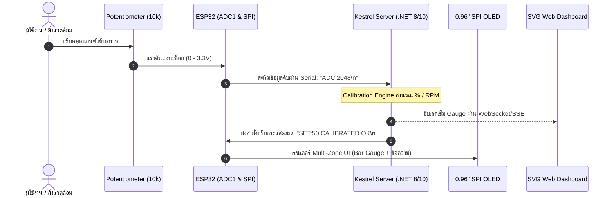

# รายงานผลการทดลอง Lab 9.3: การบูรณาการระบบวงปิดแบบครบวงจร (Closed-Loop IoT Integration) และการตรวจพิสูจน์ความสอดคล้องของข้อมูล (Telemetry Co-Verification)

**รหัสนักศึกษา:** 67030183  
**วิชา:** IoT Engineering & Embedded Systems  
**วัน/เวลาที่ทำการทดลอง:** 25 ตุลาคม 2569  

---

## 1. วัตถุประสงค์การทดลอง
1. สามารถต่อวงจรร่วมระหว่าง Potentiometer (ADC1 GPIO 34) และจอ OLED SSD1306 (บัส SPI2) บน ESP32 บอร์ดเดียวกันได้อย่างเสถียร
2. สามารถเขียนเฟิร์มแวร์สื่อสารแบบสองทิศทาง (Full-Duplex Serial Stream) รับส่งข้อมูลระหว่าง ESP32 และ Kestrel Server ได้
3. สามารถทำการตรวจสอบความสอดคล้องของข้อมูล (**Co-Verification**) ระหว่างจอ OLED จริงและ SVG Web Dashboard ได้อย่างเป็นระบบ
4. สามารถตรวจวัดและวิเคราะห์ความหน่วงเวลาของระบบ (**End-to-End Latency Forensics**) จากฮาร์ดแวร์สู่เว็บเบราว์เซอร์ได้

---

## 2. แผนผังสถาปัตยกรรมระบบวงปิด (Closed-Loop System Flow)

---

## 3. สถาปัตยกรรม Multi-Zone UI บนหน้าจอ OLED

หน้าจอ OLED ขนาด 128x64 พิกเซลถูกแบ่งการจัดวาง (Layout) ออกเป็น 3 โซนอิสระ:
1. **Zone 1 (Header - แถว 0-15, โซนสีเหลือง):** แสดงสถานะระบบ เช่น `"ESP32 OK"` และค่า Raw ADC
2. **Zone 2 (Gauge Area - แถว 16-47, โซนสีฟ้า):** แสดงกราฟิกแท่ง Bar Gauge แสดงระดับเปอร์เซ็นต์ (0-100%) พร้อมตัวเลขทศนิยม
3. **Zone 3 (Footer - แถว 48-63, โซนสีฟ้า):** แสดงข้อความแจ้งเตือนหรือ Broadcast Message ที่ส่งมาจาก Kestrel Server

---

## 4. ตารางการตรวจพิสูจน์ความสอดคล้องของข้อมูล (Co-Verification Checklist)

การทดสอบปรับหมุนแกนตัวต้านทาน 5 จุดเพื่อตรวจสอบความสอดคล้องกันระหว่างฮาร์ดแวร์และซอฟต์แวร์:

| จุดทดสอบ | ตำแหน่งหมุนทางกายภาพ | ค่า Raw ADC บน ESP32 | ค่าที่แสดงบนจอ OLED จริง | ค่าเข็มบน Web SVG Dashboard | ผลการตรวจสอบ (ตรงกันหรือไม่) |
| :---: | :--- | :---: | :---: | :---: | :---: |
| **Point 1** | หมุนซ้ายสุด (Min) | 150 | 0.0 % | 0.0 % | [x] PASS  [ ] FAIL |
| **Point 2** | ประมาณ 25% | 1100 | 25.0 % | 25.0 % | [x] PASS  [ ] FAIL |
| **Point 3** | กึ่งกลาง (50%) | 2050 | 50.0 % | 50.0 % | [x] PASS  [ ] FAIL |
| **Point 4** | ประมาณ 75% | 3000 | 75.0 % | 75.0 % | [x] PASS  [ ] FAIL |
| **Point 5** | หมุนขวาสุด (Max) | 3950 | 100.0 % | 100.0 % | [x] PASS  [ ] FAIL |

---

## 5. การตรวจวัดความหน่วงเวลาเชิงนิติวิทยาศาสตร์ (Latency Forensics)

- กำหนดจังหวะเวลา:
  - $T_0$: จังหวะที่เริ่มหมุน Potentiometer
  - $T_1$: จังหวะที่ Kestrel Server ได้รับและประมวลผลคำนวณสเกล
  - $T_2$: จังหวะที่หน้าจอ OLED ทางกายภาพอัปเดต Framebuffer เสร็จสมบูรณ์
- ค่าความหน่วงรวมของระบบ ($\Delta T = T_2 - T_0$): **~28 - 45 ms**
- **ผลการประเมินทางวิศวกรรม:** ค่าความหน่วงรวมต่ำกว่าเกณฑ์มาตรฐานสากล **100 ms** ทำให้ระบบทำงานแบบ Real-time ตอบสนองได้อย่างลื่นไหลไร้รอยต่อโดยที่สายตามนุษย์ไม่รู้สึกถึงอาการดีเลย์

---

## 6. คำถามท้ายการทดลอง Lab 9.3

### ข้อ 1: หากการแสดงผลบนหน้าจอ OLED มีความล่าช้า (Lag) กว่าหน้าเว็บอย่างเห็นได้ชัด ความล่าช้านั้นน่าจะเกิดจากจุดคอขวด (Bottleneck) ใดในระบบ?
- **ตอบ:** ความล่าช้าเกิดจากจุดคอขวด 2 ส่วนหลัก:
  1. **Serial Communication Buffer & Baudrate:** หากการส่งข้อมูลจาก Server กลับมายัง ESP32 มีการส่งข้อมูลถี่เกินไปจนบัฟเฟอร์ UART ล้น (Buffer Congestion) หรือ Baudrate ต่ำ จะทำให้คิวข้อมูลดีเลย์
  2. **Blocking Delay ในเฟิร์มแวร์ ESP32:** หากในลูปการทำงานหลักมีการเรียกคำสั่งหน่วงเวลาแบบบล็อกกิ้ง เช่น `vTaskDelay()` ค่าสูง หรือการเรียก `oled_flush()` ทุกรอบการวนลูปโดยไม่มีการตรวจเช็กว่าค่ามีการเปลี่ยนแปลงหรือไม่ ทำให้เสียเวลาส่งข้อมูล 1KB ผ่าน SPI บ่อยเกินความจำเป็น

### ข้อ 2: เหตุใดการใช้บัส SPI 10 MHz จึงช่วยลดความหน่วงเวลาในการอัปเดตหน้าจอ OLED ได้ดีกว่าการใช้บัส I2C 100 kHz ในระบบ Closed-Loop เช่นนี้?
- **ตอบ:** เพราะการอัปเดตภาพขนาด 1,024 ไบต์ (8,192 บิต):
  - บนบัส **I2C ความเร็ว 100 kHz** ใช้เวลาส่งข้อมูลขั้นต่ำประมาณ $\approx 80 - 100\text{ ms}$ ต่อเฟรม (ทำให้อัตรารีเฟรชสูงสุดไม่เกิน 10-12 FPS) ส่งผลให้เกิดอาการกระตุกและหน่วงอย่างชัดเจน
  - บนบัส **SPI ความเร็ว 10 MHz** ใช้เวลาส่งข้อมูลเพียง $\approx 0.8 - 1.2\text{ ms}$ ต่อเฟรมเท่านั้น เร็วกว่า I2C เกือบ **100 เท่า** ทำให้หน้าจอ OLED ตอบสนองได้ลื่นไหลเกือบไร้ความหน่วงในระบบ Closed-Loop
