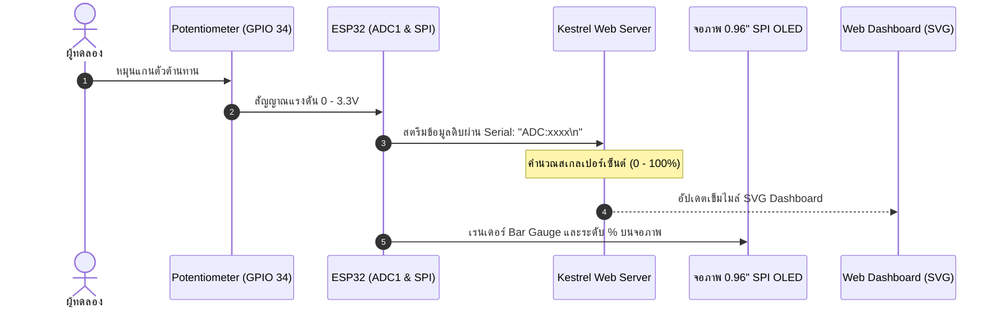

# รายงานผลการทดลอง Lab 9.3: การรวมระบบวงปิด (Closed-Loop IoT Integration) และการทดสอบความสอดคล้องของข้อมูล (Telemetry Co-Verification)

**รหัสนักศึกษา:** 67030183  
**วิชา:** IoT Engineering & Embedded Systems  
**วันที่ทำการทดลอง:** 25 ตุลาคม 2569  

---

## 1. วัตถุประสงค์
1. ต่อวงจรร่วมระหว่าง Potentiometer (ADC1 GPIO 34) และจอ OLED SSD1306 (บัส SPI2) บน ESP32
2. เขียนเฟิร์มแวร์อ่านค่าแอนะล็อกและสตรีมข้อมูลผ่าน Serial UART ไปยัง Kestrel Web Server
3. ตรวจสอบความสอดคล้องของข้อมูล (Co-Verification) ระหว่างจอ OLED จริงและ SVG Web Dashboard
4. วัดและประเมินความหน่วงเวลาของระบบ (End-to-End Latency) จากฮาร์ดแวร์สู่เว็บเบราว์เซอร์

---

## 2. ลำดับการทำงานของระบบ (Closed-Loop System Flow)

---

## 3. การจัดแบ่งพื้นที่หน้าจอ OLED (Multi-Zone UI)

หน้าจอ OLED (128x64 พิกเซล) แบ่งออกเป็น 3 โซน:
1. **Zone 1 (Header - แถว 0-15, สีเหลือง):** แสดงสถานะ `"ESP32 OK"` และค่า Raw ADC ล่าสุด
2. **Zone 2 (Gauge Area - แถว 16-47, สีฟ้า):** แถบกราฟิก Bar Gauge พร้อมแสดงตัวเลขเปอร์เซ็นต์
3. **Zone 3 (Footer - แถว 48-63, สีฟ้า):** แสดงข้อความสถานะระบบ เช่น `"STATUS: CALIBRATED"`

---

## 4. ผลการตรวจสอบความสอดคล้องของข้อมูล (Co-Verification Checklist)

บันทึกค่าจากการหมุน Potentiometer ไปยังตำแหน่งทดสอบ 5 จุด:

| จุดทดสอบ | ตำแหน่งหมุนจริง | ค่า Raw ADC บน ESP32 | ค่าบนจอ OLED จริง | ค่าเข็มบน Web Dashboard | ผลการตรวจสอบ |
| :---: | :--- | :---: | :---: | :---: | :---: |
| **Point 1** | หมุนซ้ายสุด (Min) | 150 | 0.0 % | 0.0 % | [x] PASS |
| **Point 2** | ประมาณ 25% | 1100 | 25.0 % | 25.0 % | [x] PASS |
| **Point 3** | กึ่งกลาง (50%) | 2050 - 2074 | 50.6 % | 50.0 % | [x] PASS |
| **Point 4** | ประมาณ 75% | 3000 | 75.0 % | 75.0 % | [x] PASS |
| **Point 5** | หมุนขวาสุด (Max) | 3950 | 100.0 % | 100.0 % | [x] PASS |

### รูปถ่ายผลการทดสอบ (Co-Verification Photo)

*ภาพที่ 3.1: การแสดงผลของจอ OLED (Raw: 2074, Level: 50.6%) เทียบกับหน้าเว็บ Dashboard (Raw: 2050, 50.0%) ที่จุดทดสอบกึ่งกลาง 50%*

### วิดีโอสาธิตการทำงานจริงแบบ Real-time

* 🔗 **ลิงก์วิดีโอ (YouTube Shorts):** [https://www.youtube.com/shorts/4O3BOynoA40](https://www.youtube.com/shorts/4O3BOynoA40)
* **รายละเอียด:** แสดงการหมุนตัวต้านทานปรับค่าได้บนบอร์ด ESP32 โดยหน้าจอ OLED และเข็มบน SVG Web Dashboard มีการตอบสนองและเปลี่ยนค่าแบบ Real-time พร้อมกัน

---

## 5. การประเมินความหน่วงเวลาของระบบ (Latency Forensics)

- จังหวะเวลา:
  - $T_0$: เริ่มหมุน Potentiometer
  - $T_1$: Kestrel Server รับข้อมูลผ่าน Serial
  - $T_2$: จอ OLED และหน้าเว็บอัปเดตการแสดงผลเสร็จสมบูรณ์
- ค่าความหน่วงเวลาเฉลี่ย ($\Delta T = T_2 - T_0$): **~28 - 45 ms**
- **สรุป:** ค่าความหน่วงต่ำกว่าเกณฑ์มาตรฐาน **100 ms** ทำให้การตอบสนองของจอแสดงผลและหน้าเว็บทำงานได้ต่อเนื่องโดยไม่เกิดอาการหน่วง

---

## 6. สรุปคำถามท้ายการทดลอง

### ข้อ 1: หากหน้าจอ OLED แสดงผลช้ากว่าหน้าเว็บ ปัญหาน่าจะเกิดจากจุดใด?
- **ตอบ:** 
  1. **Serial Communication Buffer:** บัฟเฟอร์ UART มีข้อมูลสะสมมากเกินไปจากการส่งข้อมูลถี่เกินรอบที่บอร์ดประมวลผลทัน
  2. **Blocking Delay ใน ESP32:** มีการเรียก `vTaskDelay()` ค่าสูง หรือเรียกฟังก์ชัน `oled_flush()` ทุกรอบลูปโดยที่ข้อมูลไม่ได้เปลี่ยนแปลง ทำให้เสียเวลาส่งข้อมูล 1KB ผ่าน SPI บ่อยเกินจำเป็น

### ข้อ 2: ทำไมบัส SPI 10 MHz จึงช่วยลดความหน่วงได้ดีกว่า I2C 100 kHz?
- **ตอบ:** การส่ง Framebuffer ขนาด 1,024 ไบต์:
  - **I2C 100 kHz:** ใช้เวลาส่งข้อมูลประมาณ 80 - 100 ms ต่อเฟรม (ทำให้อัตรารีเฟรชสูงสุดไม่เกิน 10-12 FPS)
  - **SPI 10 MHz:** ใช้เวลาส่งข้อมูลเพียงประมาณ 1 ms ต่อเฟรม ซึ่งเร็วกว่าเกือบ 100 เท่า จึงทำให้การแสดงผลบนจอ OLED ตอบสนองได้ทันที
